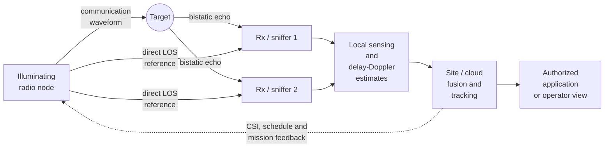
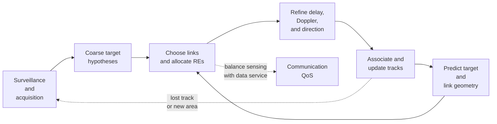
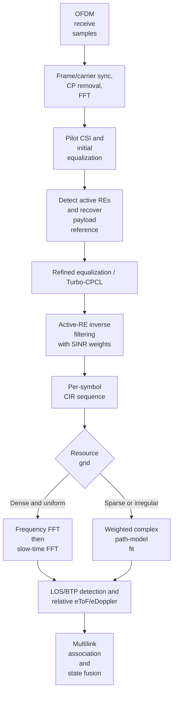
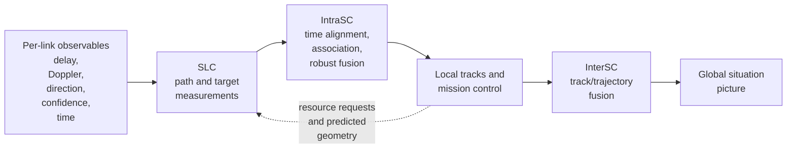

# Distributed Multisensor ISAC: Technical and Simulation Guide

This guide consolidates the system model, estimation methods, coordination
principles, and measurement example in the source paper into a simulation-first
reference. It emphasizes relationships and implementation steps rather than
reproducing the paper's figures.

## 1. Executive summary

Integrated sensing and communications (ISAC) reuses a mobile communications
network's transmitters, receivers, spectrum, OFDM waveform, synchronization,
computing, and data transport to detect and track objects that do not carry a
radio tag. **Distributed multisensor ISAC (MS-ISAC)** treats spatially separated
radio nodes as a cooperative multistatic radar network. Its sensing links jointly
illuminate and observe a target; delay, Doppler, and optionally direction
measurements from several geometries are fused into a 3D target state.

What are central engineering ideas here briefly:

1. Coordinate multiple transmit/receive links and their time-frequency
   resources, rather than treating each sensing link as an isolated radar.
2. Use **Cooperative Passive Coherent Location (CPCL)** to reconstruct the
   communication waveform as a correlation reference and estimate target
   delay/Doppler relative to the direct transmitter-to-receiver (LOS) path.
3. Use a complex, model-based delay-Doppler estimator when the OFDM resource
   grid is sparse or nonuniform; zero-filling missing resource elements before
   an FFT can create uncontrolled artifacts.
4. Exploit spatial diversity for detection and well-conditioned geometry for
   localization. More sensors do not guarantee accurate location if their
   bistatic ellipses intersect at shallow angles (high geometric dilution of
   precision, GDoP).
5. Separate local coherent sensing from higher-level data fusion: precise
   timing/phase coherence is needed within a sensing link, while site-to-site
   fusion of already estimated states can use looser absolute synchronization.

## 2. System concepts and vocabulary

| Term | Meaning |
|---|---|
| ISAC | Integrated Sensing and Communications; here, communications-centered radar sensing using the mobile radio interface. |
| MS-ISAC | Multisensor ISAC with multiple spatially distributed illuminators and/or receivers. |
| Monostatic | Transmitter and receiver are collocated or nearly collocated. |
| Bistatic / multistatic | A target is illuminated and observed from separated Tx/Rx locations; multistatic uses multiple links. |
| eToF | Excess time of flight: target-path delay relative to the direct Tx-to-Rx path. |
| eDoppler | Target-related Doppler relative to the Tx/Rx reference path, with sign dependent on convention. |
| BTP | Bistatic target path: Tx → target → Rx, including target-related scattering. |
| CIR / FRF | Channel impulse response / frequency-response function between a Tx and Rx. |
| CPCL | Cooperative Passive Coherent Location; sensing based on a reconstructed communication waveform and differential LOS/BTP measurements. |
| SLC / IntraSC / InterSC | Sensor-level cooperation / within-site or cloud cooperation / between sites or clouds. |

This is **distributed MIMO radar**, not merely a collocated MIMO array. A
network of \(N\) nodes can form \(N\) monostatic and \(N^2-N\) bistatic
measurements if each directed Tx/Rx pairing is measured. Reciprocal or
homogeneous links may make some measurements redundant; heterogeneous
forward/backward links can provide up to \(N^2\) independent measurements.
Extra links provide diversity, redundancy, outlier checks, and additional
geometric constraints.

### Three deployment patterns, need to be expanded more!

1. **Infrastructure-only:** Fixed gNB/RRU illuminators and receive-only
   “sniffer” nodes report to a centralized/cloud radio pool. It is suitable for
   persistent surveillance of roads, ports, rail yards, utilities, campuses, and
   other critical infrastructure. It avoids putting a UE in the sensing loop.
2. **UE-assisted UL/DL:** A UE may be a sensor or illuminator, with the
   infrastructure as its complementary endpoint. DL naturally supports
   broadcast illumination to multiple listening UEs; UL transmissions from
   spatially separated UEs naturally provide multiple bistatic measurements.
   UE availability, mobility, transmit power, and TDD duty cycle become part
   of the sensing problem. A receive-only sniffer can use a reduced CPCL mode;
   an authorized UE additionally enables feedback, fusion, and adaptive
   transmission.
3. **Sidelink mesh:** Cars, drones, or other mobile nodes act as both sensors
   and illuminators. The mesh can be network controlled or ad hoc, and may
   distribute sensing, computation, and communications tasks under payload,
   energy, and link-capacity constraints.



### Cooperation layers

- **SLC:** Each Tx/Rx pair synchronizes, reconstructs the reference, estimates
  paths and produces local delay/Doppler/direction measurements.
- **IntraSC:** A site or mobile cloud coordinates links and resources, aligns
  measurements in time, associates targets, and fuses local measurements.
- **InterSC:** Sites exchange target states/trajectories and create a wider
  situation picture. This layer can combine ISAC with other sensors and
  operator information; raw waveform-level coherence is not generally needed.

## 3. Propagation and measurement model

### 3.1 Link channel

For node \(n\) transmitting and node \(m\) receiving, the measured channel
frequency response can be estimated from the transmitted reference \(X_n(f)\)
and received signal \(Y_m(f)\):

\[
H_{m,n}(f) \simeq \frac{Y_m(f)}{X_n(f)}, \qquad 1\leq m,n\leq N .
\]

Stacking all links gives the distributed input/output channel matrix
\(\mathbf H(f)\in\mathbb C^{N\times N}\). Each entry includes a monostatic
diagonal or a bistatic off-diagonal link. In practice, cross-correlation or
frequency-domain system identification estimates the CIR/FRF.

### 3.2 Target, LOS, and clutter contributions

A useful bistatic decomposition is

\[
H_{m,n} = H_{\mathrm{LOS}}
 + H_{\mathrm{direct\ illumination}}H_{\mathrm{direct\ target\ response}}
 + H_{\mathrm{scattered\ illumination}}H_{\mathrm{scattered\ target\ response}}
 + H_{\mathrm{clutter}} .
\]

- **LOS** is not just interference: it supports frame/carrier synchronization,
  reference recovery, and differential eToF/eDoppler.
- **BTP components** pass through the target and carry target information.
- **Clutter** includes paths not associated with the target and can mask weak
  target echoes through sidelobes.
- A blocked direct path does not necessarily mean the target is unobservable:
  target-related multipath, spatial diversity, and known environmental
  reflections can provide alternative constraints.

For simulation, represent a link as a sum of \(P\) specular components:

\[
H(f,t)=\sum_{p=1}^{P}\gamma_p
  e^{-j2\pi f\tau_p}e^{-j2\pi t\alpha_p}+w(f,t),
\]

where \(\tau_p\) is path delay, \(\alpha_p\) is Doppler, \(\gamma_p\) is a
complex path weight (possibly polarization-dependent), and \(w\) represents
measurement noise/model error. The paper's finite observation aperture is
limited by bandwidth \(B\) and coherent observation duration \(T\). The
corresponding ideal Fourier resolutions are approximately \(1/B\) in delay and
\(1/T\) in Doppler; model-based estimation can resolve beyond these nominal
bin spacings under suitable SNR, model, and sampling conditions, but is not
unlimited or immune to ambiguity.

The complex target response can vary with aspect, frequency, polarization,
range, and time. For electrically large targets with many comparable
scattering contributions, the paper describes a circular-Gaussian field and
chi-square-like received-power variation; a dominant specular return instead
leads to a noncentral chi-square (squared-Rician) model. Extended targets
occupy correlated neighboring delay bins. These effects matter when generating
target amplitudes and independent-link fading in Monte Carlo experiments.

### 3.3 Bistatic geometry and state

Let \(\mathbf p\) be target position and \(\mathbf t_i,\mathbf r_i\) the
transmitter and receiver positions for link \(i\). The target-path length and
direct-path length are

\[
L_i(\mathbf p)=\|\mathbf p-\mathbf t_i\|+\|\mathbf p-\mathbf r_i\|,
\qquad
L_{0,i}=\|\mathbf t_i-\mathbf r_i\|.
\]

The absolute bistatic delay is \(L_i/c\); the CPCL excess delay is

\[
\tau_i^{\mathrm{ex}}=\frac{L_i(\mathbf p)-L_{0,i}}{c}.
\]

An absolute bistatic ToF measurement defines an ellipsoid with foci at Tx and
Rx. An eToF measurement defines the same family after adding the known direct
baseline. In 2D the surface is an ellipse; in 3D it is an ellipsoid. At least
three geometrically informative links are needed for a 3D position in the
basic range-only formulation. Additional measurements improve robustness
and expose outliers, but uniqueness and accuracy depend on geometry.

```text
                         target p
                       * (unknown)
                    .-' `-.
                 .-'       `-.        constant Tx-to-target +
      Tx  *------'             `------*  Rx path length
          \___________________________/
                   direct baseline

Each measured path-length sum defines an ellipsoid/ellipse.
The target is estimated from the intersection of several such surfaces.
Shallow intersection angles -> high GDoP and large position uncertainty.
```

For moving nodes and targets, define eDoppler through the time derivative of
the excess path length:

\[
\alpha_i^{\mathrm{ex}}
=-\frac{1}{\lambda}\frac{d}{dt}
 \left(L_i(\mathbf p(t))-L_{0,i}(t)\right),
\]

where \(\lambda=c/f_c\); the sign depends on the adopted complex-exponential
and approaching/receding convention. This derivative automatically includes
target and sensor velocities. It is a useful implementation definition because
it avoids ambiguity about unit-vector direction conventions. Each link measures
a different projection of target velocity. Three-dimensional velocity therefore
requires enough independent Doppler geometries; more links help resolve
ambiguities and reduce variance.

For noisy or redundant range observations, solve a nonlinear weighted least
squares problem over position, or linearize around the previous verified
position and use a pseudoinverse for a local update. The paper emphasizes
overdetermined estimation, outlier rejection (e.g., blocked LOS), and careful
link selection. Poorly crossing ellipses produce high GDoP even with accurate
individual delays.

### 3.4 Coverage and diversity

Monostatic free-space radar return falls approximately with the fourth power of
range; a simplified bistatic link budget is

\[
P_r \approx
\frac{P_tG_tG_r\lambda^2\sigma_b}
{(4\pi)^3 R_t^2R_r^2 L_{\mathrm{sys}}},
\]

where \(R_t,R_r\) are target distances from Tx/Rx, \(\sigma_b\) is
bistatic reflectivity/RCS, and \(L_{\mathrm{sys}}\) collects losses. This is a
simulation-level approximation, not a complete target/channel model from the
paper. It explains the Cassini-like coverage contours: performance is often
best near either radio node, moderate between them, and poor when far from
both. Distributed nodes trade site density and node placement for coverage,
diversity, and favorable GDoP.

## 4. Radio access and resource allocation

The communication network provides the time/frequency/spatial access toolbox,
but sensing needs coordinated measurements of a common target rather than
independent user links.

| Access option | Sensing benefit | Main cost / caveat |
|---|---|---|
| Broadcast (one Tx, many Rx) | Concurrent bistatic observations; useful for dynamic targets and sniffers. | Only a subset of all Tx/Rx pairs is observed at once. |
| OFDMA / FDMA | Separates links in frequency; supports simultaneous measurements. | Per-link occupied bandwidth controls delay/range resolution. Fragmented bands cause ambiguity/grating lobes for plain FFT processing. |
| TDMA | Separates links in time; straightforward orthogonal access. | Reduces per-link slow-time sampling and can reduce unambiguous Doppler range. |
| Joint transmission (JT) | Multiple transmitters illuminate together; potentially more target energy and spatial diversity. | Extended-target returns may be noncoherent; without waveform separation, individual bistatic geometries can be lost. |
| Spatial/polarimetric access | Raises SNR, suppresses clutter, adds directional/polarimetric observables. | Beam search, calibration, hardware constraints, and additional resource cost. |

Resource allocation must consider below items:

- Sensing SINR/detection probability and false alarm/missed detection rates.
- Delay, Doppler, angle resolution and coherent integration duration.
- Target and sensor geometry, GDoP, target motion, and range migration.
- Frequency-time sparsity, multipath selectivity, waveform/CSI quality.
- Communication throughput, latency, reliability, and fairness.
- Transport and computation cost/latency for sensors fusion.

**TDMA details:** uniform interleaving maintains the slow-time sample rate for
each link. Sharing slots lowers that rate and hence the unambiguous Doppler
span. Nonuniform scheduling can prioritize fast targets/links, but requires
estimators that honor the actual sample times. Averaging adjacent OFDM symbols
can improve SNR; coherent processing across a longer interval improves Doppler
resolution but is limited by phase stability and target range migration.

**FDMA details:** compact contiguous allocation yields conventional range
resolution. At fixed total bandwidth, fragmented allocation may increase
effective frequency spread but causes sidelobes/grating lobes, so the FFT of
zero-filled samples is not a reliable general estimator.

**CRB-driven scheduling:** for model parameters
\(\boldsymbol\theta=[\tau_p,\alpha_p,\gamma_p]\), parameter variance is bounded
by

\[
\operatorname{var}(\theta_i)\geq
\operatorname{CRB}(\theta_i)=
[\mathbf F^{-1}(\boldsymbol\theta)]_{ii},
\quad
F_{ij}\propto \frac{2}{\sigma^2}
\operatorname{Re}\left\langle
\frac{\partial H}{\partial\theta_i},
\frac{\partial H}{\partial\theta_j}\right\rangle .
\]

The Fisher information is additive over observed resource elements. For delay
estimation, allocating energy near the available spectrum edges increases
RMS bandwidth and can reduce the bound. A practical heuristic from the paper
is to place links with tighter delay/Doppler resolution needs toward outer
frequency/time regions and links with looser needs toward the interior, while
interleaving links as needed. For realistic multiple-target/multipath scenarios,
compute the FIM from the actual masked resource grid and optimize resource
allocation under communication and sensing constraints; do not assume one
universal schedule.

The paper proposes a **sensing-cycle** concept: (1) broad surveillance and
acquisition, accepting coarse/ambiguous detections; (2) targeted refinement
with changed repetition rate, coherent interval, bandwidth, and beam; (3)
tracking with predictive link/resource adaptation. AI may help with this
nonconvex multi-objective scheduling problem, but is a proposed direction, not a
specified algorithm or trained model in the article.

### Example PRB policy: one downlink gNB and multiple receive-only sensors

Assume one gNB illuminates the scene in downlink and \(M\) spatially separated,
receive-only sensors listen to it. This is the paper's **broadcast** access
case: every sensor can observe the same gNB transmission at the same time.
Therefore, do **not** divide the gNB's PRBs by \(M\). The sensors produce
different bistatic measurements from their different locations; a sensor with
poor geometry or echo SNR may contribute little, but giving it a separate PRB
does not fix that by itself. This plan does not cover sensors that also transmit;
multiple active illuminators need coordinated orthogonal access or a designed
joint-transmission scheme.

Use the following as an initial scheduler policy, not as a PRB percentage
specified by the paper. Let \(B\) be the downlink PRB-symbol budget available
for PDSCH after mandatory control, reference-signal, and guard overhead. Count
resource in PRB-symbols so that frequency and time allocations are comparable.

| Sensing cycle | gNB scheduler action | Incremental downlink cost |
|---|---|---|
| Surveillance / acquisition | Schedule ordinary PDSCH for communication and let all sensors observe eligible payload REs using CPCL/reference reconstruction. Do not reserve sensing-only PRBs initially. | No sensing-only PDSCH reservation; actual sensing still requires receiver processing and measurement reporting. |
| Target refinement | If measured detection/CRB targets are missed, start with a sensing-only allocation of \(0.05B\), selected from otherwise schedulable data resources. Use known/PRS-like illumination where supported; choose frequency edges for delay precision and suitable repeated time samples for Doppler. | About 5% fewer PRB-symbols remain for PDSCH than in the no-reservation baseline, if this resource would otherwise carry data. |
| Tracking | Recompute the sensing need from the current CSI/KPI, target motion, and geometry each scheduling window. Keep the reservation at 0% when shared payload meets the requirement; otherwise adjust it in 5-point steps, initially testing no more than \(0.10B\). | Data capacity falls only for the fraction made exclusive to sensing; the 10% value is an experiment cap, not a universal optimum. |

For example, with \(B=100\) normalized schedulable PRB-symbol units, a 5-unit
refinement reservation leaves at most 95 units for PDSCH; the other 95 can
still serve both communication and sensing when their payload is usable as a
sensing reference. This is a resource-budget illustration, not a prediction
that throughput falls by exactly 5%: actual goodput depends on MCS, traffic
demand, retransmissions, and the particular NR overhead and scheduling
configuration. If the sensing-only reservation takes resources that would
otherwise be idle, its immediate user-throughput cost may be zero.

At each update, the scheduler should:

1. Form a candidate set of sensor links using geometry/GDoP, echo SNR, and
   target visibility; all selected receive-only sensors may listen to the same
   transmission.
2. First use eligible communication payload REs. Add exclusive sensing REs
   only when the required detection probability, delay/Doppler CRB, or track
   continuity is not met, while enforcing the communication rate/latency
   floor.
3. Allocate compact frequency bands when using conventional FFT processing;
   if resources are fragmented or sparse, pass the actual RE mask to a
   sparse/model-based estimator rather than treating missing REs as measured
   zeros. Prioritize frequency edges for demanding delay precision and
   adequate slow-time repetition for demanding Doppler precision.
4. Include uplink measurement reports and fusion transport in the capacity
   budget separately; these consume resources even though the receive-only
   sensors do not each need a separate downlink PRB allocation.

This operational example applies the paper's broadcast access, payload reuse,
adaptive sensing cycles, and CRB-guided scheduling principles. The paper does
not prescribe the 5% starting point or 10% test cap; those are explicit,
adjustable starting assumptions for a scheduler simulation and should be
swept against both sensing KPIs and communication goodput. See Thomä et al.,
[“Distributed multisensor ISAC”](https://doi.org/10.1038/s44459-026-00041-2),
especially the MS radio access discussion (pp. 11–13) and resource scheduling
(pp. 18–19).



## 5. CPCL reference recovery and delay-Doppler processing

### 5.1 Why the reference matters

Conventional PCL compares a surveillance signal with a clean copy of the
transmitted waveform, traditionally acquired by a separate directional receive
channel. CPCL uses the communication system's synchronization and reference
signals and reconstructs the transmitted payload from the received OFDM signal.
The direct LOS and BTP are observed in the same CIR, allowing eToF/eDoppler
differences to cancel common Tx/Rx clock and oscillator offsets. The reduced
sniffer mode can use received transmissions without active transmitter
coordination; full CPCL can additionally exploit network feedback, transmitter
adaptation, and data fusion.

The receiver must account for empty resource elements, unequal pilot/data
power, QAM symbol magnitudes, and RF-chain distortion. Inverse filtering all
carriers indiscriminately can amplify noise or introduce incorrect samples.



### 5.2 Turbo-CPCL processing algorithm

1. **Synchronize and demodulate:** use network timing/carrier synchronization;
   remove the cyclic prefix and FFT the OFDM symbols.
2. **Estimate an initial channel:** estimate CSI at pilots and interpolate for
   initial equalization.
3. **Recover the reference:** detect active/empty resource elements (e.g.,
   DMRS information or a null-hypothesis test in reduced mode), equalize the
   received communication payload, and form an initial reconstructed reference.
4. **Refine iteratively:** use the payload estimate and the full transmitted
   power/resource structure to improve channel equalization/reference recovery.
   The refined reference captures linear and nonlinear transmitter distortion
   present over the air; avoid assuming the ideal digital constellation is the
   exact emitted waveform.
5. **Estimate per-symbol FRF:** on active carriers, use the reference-normalized
   relation
   \[
   \widehat H(f)=\frac{Y(f)X_{\mathrm{ref}}^*(f)}
   {|X_{\mathrm{ref}}(f)|^2}
   =\frac{Y(f)}{X_{\mathrm{ref}}(f)}.
   \]
   Exclude empty carriers and weight low-SNR samples less; use regularization
   rather than unstable division near zero magnitude.
6. **Form CIRs:** transform over frequency for each symbol to obtain a sequence
   of channel impulse responses. Record LOS and target-related returns.
7. **Estimate Doppler:** coherently transform the CIR sequence over slow time.
   The coherent processing interval \(T\) sets nominal Doppler resolution
   (\(\sim1/T\)).
8. **Detect and localize:** separate LOS, target, and clutter components;
   measure target delay/Doppler relative to LOS; associate link measurements
   and fuse them into position/velocity.

### 5.3 FFT versus model-based estimation

With a fully and uniformly occupied OFDM grid, a frequency FFT followed by a
slow-time FFT is efficient and produces the delay-Doppler scattering function.
The ambiguity function (AF) of a finite \(B\times T\) aperture has sinc-like
mainlobes and sidelobes; weak targets can be hidden by stronger clutter. FFT
bin maxima also quantize parameters, and long coherent intervals can blur
moving targets through range-Doppler migration.

For sparse/nonuniform resource elements, **do not substitute zero for an
unobserved channel sample and treat it as data**. This changes the AF and can
create uncontrolled sidelobes. Instead, fit the physical channel model only at
the actually observed resource elements:

\[
(\widehat{\boldsymbol\tau},\widehat{\boldsymbol\alpha},
\widehat{\boldsymbol\gamma})
=\arg\min_{\boldsymbol\tau,\boldsymbol\alpha,\boldsymbol\gamma}
\sum_{k\in\Omega} w_k
\left|H_{\mathrm{obs}}(f_k,t_k)-
\sum_{p=1}^{P}\gamma_p
e^{-j2\pi f_k\tau_p}e^{-j2\pi t_k\alpha_p}\right|^2 .
\]

Here \(\Omega\) is the observed RE set and \(w_k\) reflects sample reliability.
This is a weighted complex least-squares / maximum-likelihood formulation
under appropriate noise assumptions. It interpolates the sampled complex
response according to the propagation model and can separate overlapping
components more effectively than magnitude-domain CLEAN. Model order \(P\)
must be selected or estimated; the article does not prescribe one universal
order-selection rule. Recursive estimation is suggested for real-time operation.

For improved estimates:

- jointly estimate delay and Doppler, then add angle/direction and polarization
  where hardware/calibration allows;
- use local off-grid refinement after FFT initialization if FFT is used;
- model the actual irregular RE pattern, symbol timing, and per-RE SNR;
- use a device model for frequency response, phase noise, I/Q imbalance,
  nonlinearities, and array-pattern calibration when those effects matter;
- use CRB/FIM calculations with the actual resource mask to compare schedules
  and estimate achievable variance.

## 6. Synchronization, precoding, and spatial sensing

### 6.1 Differential synchronization

Communication synchronization (PSS/SSS, DMRS/PT-RS, cyclic prefix) gives a
useful baseline for frame coordination. High-accuracy bistatic delay and
Doppler can demand finer timing and carrier-phase stability than ordinary data
decoding. CPCL mitigates this by estimating LOS and BTP from the same
reference/channel record and taking their delay/frequency differences. This
avoids requiring perfectly aligned independent Tx/Rx clocks for every
measurement, provided the reference is correctly reconstructed and the LOS
can be identified.

For higher-level fusion, use absolute timestamps and align measurements to a
common time. The paper cites approximately ±130 ns timing and 0.05 ppm
frequency synchronization as 5G infrastructure figures; these are context,
not universal design guarantees. GNSS/GPSDO, IEEE 1588 PTP/White Rabbit, and
network-based methods are discussed as possible references. Moving mesh nodes
need explicit treatment of clock drift, sensor motion, phase drift, and stale
data. Doppler compensation should follow the LOS reference, not an arbitrary
composite of LOS and multipath.

### 6.2 Multipath exploitation

- **Background subtraction:** for static sensors and static clutter, subtract a
  stored or slowly updated background so moving-target returns remain. It is
  harder when the sensors move or the environment changes.
- **Time-reversal focusing (TRF):** estimate a channel, conjugate/time-reverse
  its response, and precode using CSI feedback. The effective channel is
  autocorrelation-like and can focus energy in delay/space. It requires the
  channel to remain sufficiently stable over estimation, feedback, and
  transmission. The paper's illustrative measured-channel example used 3.75 GHz
  and 100 MHz bandwidth; a roughly four-wavelength displacement caused about
  10 dB correlation loss in that example.
- **Target-aware focusing:** remove target-independent clutter before
  precoding; otherwise end-to-end focusing may focus clutter as well as the
  target. Extended-target response may be stochastic/noncoherent, so
  increasing reflected energy is often more defensible than assuming coherent
  focusing on a single scatterer.
- **Doppler precoding:** compensate a predicted target Doppler to extend
  coherent integration, subject to motion/model error.
- **Ray-tracing / fingerprint methods:** known reflectors can act as virtual
  anchors in model-based localization; fingerprints can be learned or compared
  with a digital-twin database. These are complementary approaches, not a
  replacement for careful path association.
- **Multifrequency and polarization:** lower frequencies aid coverage and
  diffraction/penetration; higher bandwidth and arrays can improve resolution
  and SNR but increase blockage/beam-management sensitivity. Polarimetric
  Tx/Rx channels can characterize target response with a \(2\times2\) Jones
  matrix; antenna and target coordinate frames must be calibrated.

### 6.3 Beamforming and direction estimation

Beamforming increases link SNR and can filter clutter. Bidirectional Tx/Rx
beamforming can retain a clean LOS reference while selecting target returns.
It requires beam search and calibrated patterns. Hybrid/analog beamforming
often hides individual antenna outputs, limiting direct MUSIC/ESPRIT array
processing.

The paper describes an alternative using overlapping, shift-invariant beams
whose phase centers differ. Their phase difference provides high-resolution
direction information with fewer digital ports than physical antenna elements.
Multiple translated subarrays can extend this to multiple arrivals, provided
patterns and phase relationships are calibrated. For DoD, transmit waveforms
must be distinguishable, usually through orthogonal time-frequency resources.

## 7. Data fusion and tracking

At each link, local processing yields delay, Doppler, direction, confidence,
and timestamp. Fusion must address target association, non-isochronous
measurements, missing/occluded paths, link-specific uncertainties, and
network latency.

Recommended separation:

1. **Sensor link:** estimate paths and local target observables; report quality,
   timestamp, covariance/confidence, and sensor pose/velocity.
2. **Site/cloud:** align times (prefer prediction to a common epoch), select
   geometrically useful sensors, reject outliers, solve a weighted nonlinear
   state estimate, and update target tracks.
3. **Inter-site:** exchange tracks/trajectories or summarized observations;
   perform global association and situation-level fusion.

Kalman-family trackers can model 3D position, velocity, and optionally
acceleration/orientation. Multi-target data association can use methods such as
MHT or JPDA. Tracking provides smoothing, prediction through missed detections,
and a basis for predictive resource allocation. Early/raw fusion preserves
information but increases transport/computation demands; late fusion of local
estimates is more modular and can reduce shared data. Keep uncertainty and
measurement age attached to all reports.



## 8. Simulation recipe

The following is a practical baseline for a new simulator. It is an
implementation plan derived from the paper, not code or a parameter set
published by the authors.

### 8.1 State and configuration

Define a configuration with:

- carrier frequency \(f_c\), occupied bandwidth \(B\), OFDM numerology,
  subcarrier/symbol spacing, CP, coherent interval \(T\), and frame schedule;
- node positions, velocities, antennas, Tx power, frequencies, and clock/LO
  offsets;
- target position, velocity, optional acceleration/extent/orientation, and
  reflection model;
- link set / resource mask \(\Omega_i\), per-link power, and SNR;
- clutter paths, blockage, multipath, measurement noise, and RF impairments;
- fusion epoch, communication/transport delay, and data-dropout model.

Use SI units consistently. Keep **absolute path delay**, **excess delay**, and
**Doppler sign convention** explicit in code and result files.

### 8.2 End-to-end algorithm

```text
Input: node states, target states, channel/resource configuration, noise model

1. Generate candidate Tx/Rx links and their time-frequency resource masks.
2. For each link and coherent frame:
   a. Compute LOS, target, target-multipath, and clutter path delays/Dopplers.
   b. Generate complex path weights, including aspect/polarization/fading.
   c. Sample H(f,t) only on allocated REs; apply waveform and RF impairments.
   d. Add receiver noise; optionally model blockage, clock, and phase drift.
   e. Recover reference and estimate H on active REs (CPCL processing).
   f. Estimate paths:
      - uniform dense grid: FFT-based initialization;
      - sparse/irregular grid: weighted complex model fit.
   g. Detect target paths; measure eToF/eDoppler relative to LOS.
3. Time-align per-link measurements and transform to a common coordinate frame.
4. Associate measurements with target hypotheses; reject inconsistent/outlier links.
5. Estimate position/velocity with weighted nonlinear LS, then update tracks.
6. Compute sensing KPIs and communication/resource costs.
7. Optionally adapt selected links, RE allocation, beam, or integration time;
   repeat for the next sensing cycle.
Output: per-link estimates, fused tracks, uncertainty, detection statistics,
        resource use, latency, and communication performance.
```

### 8.3 Estimation and fusion blocks

**Reference and channel estimation:** apply inverse filtering only on active
carriers. Use a noise-aware denominator/regularizer and weighted fitting when
power varies across data carriers. Model the true RE mask rather than
interpolating missing samples as if measured.

**Delay-Doppler detection:** retain complex samples for model fitting. For
FFT-based plots, label axes in seconds and hertz and preserve the true slow-time
sampling schedule. When target motion changes delay appreciably over \(T\),
shorten coherent processing or use a joint range-Doppler/range-migration model.

**Position/velocity solve:** use an objective such as

\[
\widehat{\mathbf p}
=\arg\min_{\mathbf p}\sum_i w_i
\left(\widehat{\tau}^{\mathrm{ex}}_i-
\frac{\|\mathbf p-\mathbf t_i\|+\|\mathbf p-\mathbf r_i\|
-\|\mathbf t_i-\mathbf r_i\|}{c}\right)^2,
\]

and fit velocity by minimizing residuals between measured eDoppler and the
time derivative of the modeled excess path. For moving nodes, propagate node
states to each measurement timestamp. Use robust losses or gating for
outliers, then report covariance/CRB or empirical uncertainty.

### 8.4 Minimum experiment matrix

| Dimension | Cases to compare |
|---|---|
| Geometry | well-conditioned vs shallow ellipse intersections; varying Tx/Rx baseline; node density. |
| Waveform/grid | dense OFDM, TDMA-interleaved, compact FDMA, fragmented/sparse REs. |
| Estimator | 2D FFT with dense data; zero-filled sparse FFT as a negative control; weighted model fit. |
| Propagation | LOS and clutter; target near Tx/Rx; target multipath; blocked LOS; correlated/extended target. |
| Synchronization | ideal, fixed timing/frequency offset, drift/phase noise, CPCL differential cancellation. |
| Motion | stationary target, radial/tangential motion, sensor motion, range migration. |
| Coordination | broadcast, orthogonal links, JT, adaptive sensing cycles. |
| Precoding | none, beamforming, background subtraction, channel-matched TRF with channel aging. |

Report probability of detection versus false alarm, delay/Doppler RMSE, 3D
position and velocity RMSE, track continuity/false tracks, GDoP, CRB, SNR,
resource utilization, communication throughput/latency, and fusion delay.
Sweep SNR and repeat independent target/channel realizations; separate
algorithmic error from geometry and synchronization error. Include confidence
intervals rather than a single realization. Compare estimated covariance with
empirical error to detect model mismatch.

### 8.5 Published measurement example (reference check)

The article's demonstration is a **measurement**, not a simulation data set:

- Three stationary radio nodes (one Tx and two Rx) were mounted on cars; a
  target car moved through the scene.
- USRP X310 radios; 33 dBm transmit power; 5.2 GHz carrier; 80 MHz bandwidth.
- A periodically repeated multisine had a 3.2 \(\mu\)s period and uniform
  carrier magnitude, with phases chosen for low peak-to-average power ratio.
  The known transmitted waveform was correlated at the receivers; GPSDOs
  synchronized the nodes.
- Slow-time observation was about 50 ms. The target was barely visible in the
  power-delay profile, including after background subtraction, but appeared
  clearly in delay-Doppler maps.
- Reported target estimates: Rx1 at 137 ns eToF and 380 Hz eDoppler; Rx2 at
  98 ns eToF and 355 Hz eDoppler.
- The two eToF constraints did not uniquely/localization-robustly intersect;
  sensor placement yielded high GDoP. This is a useful negative lesson:
  detecting a target on multiple links does not ensure a well-conditioned
  position estimate.

The authors state that the data set and code are not publicly available; the
example is therefore a qualitative reference point, not a directly
reproducible benchmark.

## 9. Practical pitfalls and decision checklist

- **Do not conflate delay and range:** bistatic range is a sum of two ranges;
  CPCL commonly measures excess path length after subtracting the Tx/Rx
  baseline.
- **Do not assume the brightest path is the target:** LOS/clutter may dominate;
  use Doppler, background, geometry, and path models.
- **Do not zero-fill missing REs as true observations:** model the sparse mask.
- **Do not equate array beam selection with high-resolution DoA:** phase
  comparison/calibration is needed for sub-beam direction estimates.
- **Do not maximize link count blindly:** select for independent geometry,
  SNR, and timing; surplus links are useful for robustness if transport allows.
- **Do not extend coherent integration without checking phase coherence and
  range migration.**
- **Do not expect fully coherent joint transmission from an extended,
  statistically varying target; noncoherent illumination may be the realistic
  diversity/energy objective.**
- **Do not ignore the communication service:** sensing REs, pilots, feedback,
  and reports compete for channel, latency, and compute budgets.
- **Do not report a position without uncertainty, timestamp, geometry quality,
  and measurement provenance.**

## 10. Source outline and limits

The paper covers architecture/use cases, distributed channel and target
propagation, multistatic target geometry, radio access and OFDMA scheduling,
CPCL reference recovery, model-based delay-Doppler estimation, CRB-driven
resource allocation, time-reversal and spatial precoding, synchronization,
fusion/tracking, and the measurement example summarized above. It is a
principles/review article: detailed propagation simulation, a complete
end-to-end scheduler, and a public implementation are outside its scope.
